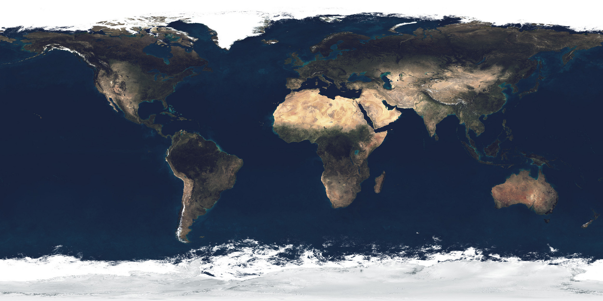

# 🌌 The Complete Universe & Milky Way Explorer (Three.js)

An interactive, scientifically accurate 3D simulation spanning from **Humanity's Satellites (ISS, Hubble, JWST, Voyager)** and our **Solar System** out to the **Whole Milky Way Galaxy (Sagittarius A*, Spiral Arms, Nebulae)**. Designed for educators, students, and space enthusiasts.



---

## 🌟 What's Inside

### 1. 🌌 The Whole Milky Way Galaxy (Real Astrophysical Model)
- **140,000+ Stars**: Mathematically plotted using logarithmic spiral density distributions ($r = a \cdot e^{b\cdot\theta}$) and differential galactic rotation.
- **Population I vs II Stars**: Luminous blue young star clusters and pink H II starburst regions along the arms; ancient golden Population II stars in the central bar and bulge.
- **Sagittarius A\***: Supermassive black hole (4.3 million solar masses) with pitch-black event horizon, relativistic doppler-beamed accretion disk, and glowing photon ring.
- **All Major Spiral Features**:
  - **Perseus Arm** & **Scutum-Centaurus Arm** (Major arms)
  - **Sagittarius Arm** & **Norma Arm**
  - **Orion-Cygnus Arm (The Orion Spur)** with pulsing gold beacon: *"★ Solar System (You Are Here)"* at 26,000 light-years from the core.
- **Iconic Nebulae & Globular Clusters**:
  - **Orion Nebula (M42)** (Stellar nursery)
  - **Eagle Nebula (M16 / Pillars of Creation)**
  - **Carina Nebula (NGC 3372)**
  - **Omega Centauri (NGC 5139)** (Ancient 10-million-star globular cluster)

### 2. 🛰️ Real Human Satellites & Interstellar Probes
- **International Space Station (ISS)**: Modeled in Low Earth Orbit (LEO, 420 km altitude, 51.6° inclination) with pressurized modules, truss, and 4 dual solar wings.
- **Hubble Space Telescope (HST)**: High-altitude optical telescope with open aperture door and solar arrays.
- **James Webb Space Telescope (JWST)**: Stationed at **Sun-Earth Lagrange Point L2** (~1.5M km from Earth) with its 5-layer Kapton sunshield and 18 gold hexagonal mirror segments.
- **GPS Constellation (Navstar)**: Demonstrating Medium Earth Orbit (MEO) multi-plane atomic clock triangulation.
- **Voyager 1 & Voyager 2**: Farthest human artifacts in history exiting into interstellar space (~163 AU & ~136 AU), complete with the 3.7m parabolic dish and the **Golden Record**.
- **Parker Solar Probe**: The fastest spacecraft in human history skimming through the blistering solar corona with a carbon-composite heat shield.

### 3. 🪐 Complete Real Solar System
- The Sun with animated convective plasma turbulence and corona bloom.
- All 8 planets (Mercury, Venus, Earth, Mars, Jupiter, Saturn, Uranus, Neptune) + Pluto.
- Moons (Luna, Phobos, Deimos, Io, Europa, Ganymede, Callisto, Titan, Triton, Charon).
- Saturn & Uranus rings with transparency.
- 5,000+ instanced asteroids in the Main Belt and icy Kuiper Belt.

### 4. 🎓 Classroom Teaching & Student Learning Suite
- **Classroom Lessons**: 5 step-by-step guided curriculum chapters with automatic 3D camera flight to every subject.
- **Interactive Student Quiz**: 5-question astronomy challenge with instant feedback, explanations, and a "🔭 Inspect in 3D" button.
- **Powers of Ten Scale Explorer**: Interactive ruler from human scale ($10^0$ m) to the ISS ($10^2$ m), Earth ($10^7$ m), Sun ($10^9$ m), Voyager ($10^{14}$ m), and Milky Way ($10^{21}$ m).
- **Astronomical Dossier Panel**: In-depth scientific facts, orbital parameters, physical characteristics, and learning takeaways.
- **Synthesized Space Ambient Drone**: Relaxing cosmic audio generated via the Web Audio API.

---

## 🚀 Running the Project

The dev server is live at:
👉 **[http://localhost:5173/](http://localhost:5173/)**

```bash
# Start local dev server
npm run dev

# Build for production
npm run build
npm run preview
```

---

## 🎮 Controls & Shortcuts

| Action | Shortcut / Control |
|---|---|
| **Rotate / Orbit View** | Left Click + Drag |
| **Pan Camera** | Right Click + Drag / Two-finger Drag |
| **Zoom In / Out** | Scroll Wheel / Pinch |
| **Milky Way Galaxy View** | `M` key or "Milky Way" scale button |
| **Solar System Overview** | `R` key or "Overview" button |
| **Jump to Earth** | `E` key |
| **Jump to ISS (Space Station)** | `I` key |
| **Pause / Resume Simulation** | `Spacebar` or Pause button |
| **Open Classroom Lessons** | Click **🎓 Lessons** in the top bar |
| **Start Student Quiz** | Click **📝 Student Quiz** in the top bar |
| **Powers of Ten Scale** | Click **📏 Powers of 10** in the top bar |
